

  <strong>中文</strong> 默认展开 · English version is below

<strong>中文</strong>

<picture>
  <source media="(prefers-color-scheme: dark)" srcset="./assets/profile-hero-zh-dark.svg" />
  <source media="(prefers-color-scheme: light)" srcset="./assets/profile-hero-zh-light.svg" />
  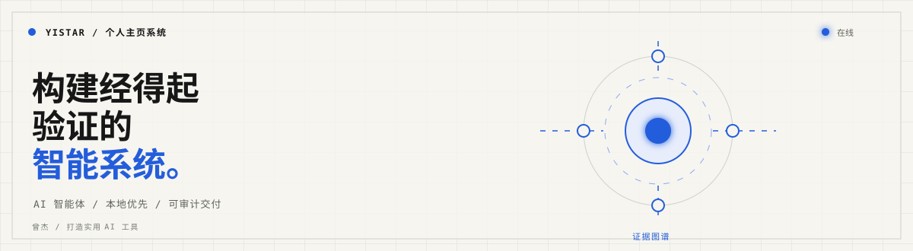
</picture>

  我做让 AI 编程 Agent <strong>可控、可验证、可接入日常工作流</strong>的开源工具： 
  从 ChatGPT 网页驱动本地 Agent，到执行前对齐需求，再到可审计的本地执行。

<picture>
  <source media="(prefers-color-scheme: dark)" srcset="./assets/profile-intro-zh-dark.svg" />
  <source media="(prefers-color-scheme: light)" srcset="./assets/profile-intro-zh-light.svg" />
  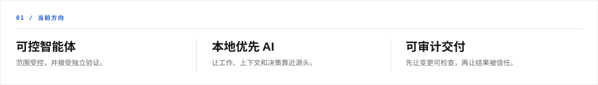
</picture>

  <a href="https://yistar.jiezeng2004.me">个人网站</a>
  &middot;
  <a href="https://github.com/jiezeng2004-design?tab=repositories&type=source">全部原创仓库</a>
  &middot;
  <a href="https://github.com/jiezeng2004-design/dsh-chatgpt-bridge">dsh-chatgpt-bridge</a>
  &middot;
  <a href="https://github.com/jiezeng2004-design/PatchWarden">PatchWarden</a>

---

### `// 代表项目`

<table>
  <tr>
    <td colspan="2" valign="top">
      <code>最受欢迎 / 01</code>
      
<strong><a href="https://github.com/jiezeng2004-design/dsh-chatgpt-bridge">dsh-chatgpt-bridge - 查看仓库 &rarr;</a></strong>

      <a href="https://github.com/jiezeng2004-design/dsh-chatgpt-bridge">
        <picture>
          <source media="(prefers-color-scheme: dark)" srcset="./assets/project-dshbridge-zh-dark.svg" />
          <source media="(prefers-color-scheme: light)" srcset="./assets/project-dshbridge-zh-light.svg" />
          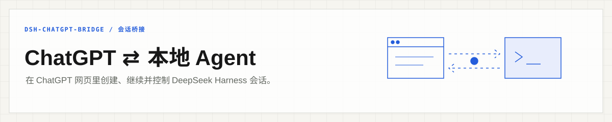
        </picture>
      </a>
      
<strong>MCP 桥接器：在 ChatGPT 网页中创建、查看、继续并控制 DeepSeek Harness Agent 会话。</strong>

      
  <code>JavaScript</code> <code>MCP</code> <code>ChatGPT</code>

      
<a href="https://github.com/jiezeng2004-design/dsh-chatgpt-bridge">仓库</a> &middot; <a href="https://github.com/jiezeng2004-design/dsh-chatgpt-bridge/releases">发行版</a>

    </td>
  </tr>
  <tr>
    <td colspan="2" valign="top">
      <code>护栏系统 / 02</code>
      
<strong><a href="https://github.com/jiezeng2004-design/PatchWarden">PatchWarden - 查看仓库 &rarr;</a></strong>

      <a href="https://github.com/jiezeng2004-design/PatchWarden">
        <picture>
          <source media="(prefers-color-scheme: dark)" srcset="./assets/project-patchwarden-zh-dark.svg" />
          <source media="(prefers-color-scheme: light)" srcset="./assets/project-patchwarden-zh-light.svg" />
          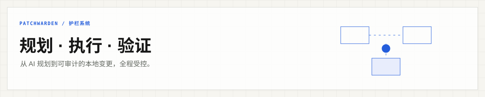
        </picture>
      </a>
      
<strong>将已确认的 AI 计划转化为受约束、可审计的本地执行。已收录于 awesome-mcp-servers。</strong>

      
  <code>TypeScript</code> <code>MCP</code> <code>独立验证</code>

      
<a href="https://github.com/jiezeng2004-design/PatchWarden">仓库</a> &middot; <a href="https://github.com/jiezeng2004-design/PatchWarden/releases">发行版</a> &middot; <a href="https://patchwarden-showcase-redesign.yistart.chatgpt.site">演示页</a>

    </td>
  </tr>
  <tr>
    <td width="50%" valign="top">
      <code>需求对齐 / 03</code>
      
<strong><a href="https://github.com/jiezeng2004-design/dsh-requirements-alignment">dsh-requirements-alignment &rarr;</a></strong>

      <a href="https://github.com/jiezeng2004-design/dsh-requirements-alignment">
        <picture>
          <source media="(prefers-color-scheme: dark)" srcset="./assets/project-alignment-zh-dark.svg" />
          <source media="(prefers-color-scheme: light)" srcset="./assets/project-alignment-zh-light.svg" />
          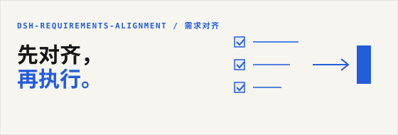
        </picture>
      </a>
      
<strong>执行前对齐关键决策，让 Agent 少猜测、少返工，不需要整套 spec 流程。</strong>

      
 <code>TypeScript</code> <code>npm</code>

      
<a href="https://github.com/jiezeng2004-design/dsh-requirements-alignment">仓库</a> &middot; <a href="https://www.npmjs.com/package/dsh-requirements-alignment">npm</a>

    </td>
    <td width="50%" valign="top">
      <code>会话引用 / 04</code>
      
<strong><a href="https://github.com/jiezeng2004-design/agentref">agentref &rarr;</a></strong>

      <a href="https://github.com/jiezeng2004-design/agentref">
        <picture>
          <source media="(prefers-color-scheme: dark)" srcset="./assets/project-agentref-zh-dark.svg" />
          <source media="(prefers-color-scheme: light)" srcset="./assets/project-agentref-zh-light.svg" />
          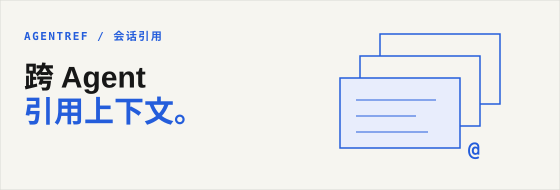
        </picture>
      </a>
      
<strong>本地、只读地跨 AI 编程 Agent 引用历史会话，为 Codex 与 Claude Code 提供原生菜单。</strong>

      
 <code>Python</code> <code>Codex</code> <code>Claude Code</code>

      
<a href="https://github.com/jiezeng2004-design/agentref">仓库</a>

    </td>
  </tr>
</table>

<!-- profile:auto:latest-zh:start -->
### `// 更多项目`

<table>
  <tr>
    <td width="50%" valign="top">
      <code>LOCAL GATEWAY / v0.3.3</code>
      
<strong><a href="https://github.com/jiezeng2004-design/relay-forge">RelayForge &rarr;</a></strong>

      
本地优先的 AI 编程网关：组合路由、回退、隐私日志，兼容 OpenAI/Anthropic 接口。

      
<code>JavaScript</code> <code>Gateway</code> <code>Local-first</code>

      
<a href="https://github.com/jiezeng2004-design/relay-forge">仓库</a> &middot; <a href="https://github.com/jiezeng2004-design/relay-forge/releases/tag/v0.3.3">v0.3.3</a>

    </td>
    <td width="50%" valign="top">
      <code>WORK MEMORY / v1.4.3</code>
      
<strong><a href="https://github.com/jiezeng2004-design/CodexJournal-Lite">CodexJournal-Lite &rarr;</a></strong>

      
把本地 Codex 会话归档为可检索的私有工作记忆与仪表盘。

      
<code>JavaScript</code> <code>Codex</code> <code>Local-first</code>

      
<a href="https://github.com/jiezeng2004-design/CodexJournal-Lite">仓库</a> &middot; <a href="https://github.com/jiezeng2004-design/CodexJournal-Lite/releases/tag/v1.4.3">v1.4.3</a>

    </td>
  </tr>
  <tr>
    <td width="50%" valign="top">
      <code>MODEL PROBING / v0.1.0</code>
      
<strong><a href="https://github.com/jiezeng2004-design/ProbeMux">ProbeMux &rarr;</a></strong>

      
一次探测，处处配置：以证据为先探测模型能力，并生成各编程 Agent 的配置。

      
<code>TypeScript</code> <code>CLI</code> <code>LLM</code>

      
<a href="https://github.com/jiezeng2004-design/ProbeMux">仓库</a> &middot; <a href="https://github.com/jiezeng2004-design/ProbeMux/releases/tag/v0.1.0">v0.1.0</a>

    </td>
    <td width="50%" valign="top">
      <code>DESKTOP THEME / v0.3.0</code>
      
<strong><a href="https://github.com/jiezeng2004-design/XJTU-Codex-Theme">XJTU-Codex-Theme &rarr;</a></strong>

      
面向 Codex Desktop 的免重启主题，含 XJTU 预设与自定义模板。

      
<code>JavaScript</code> <code>Electron</code> <code>Theme</code>

      
<a href="https://github.com/jiezeng2004-design/XJTU-Codex-Theme">仓库</a> &middot; <a href="https://github.com/jiezeng2004-design/XJTU-Codex-Theme/releases/tag/v0.3.0">v0.3.0</a>

    </td>
  </tr>
</table>
<!-- profile:auto:latest-zh:end -->

其他作品：<a href="https://github.com/jiezeng2004-design/creator-pulse">creator-pulse</a> &middot; <a href="https://github.com/jiezeng2004-design/x-algorithm-auditor">x-algorithm-auditor</a> &middot; <a href="https://github.com/jiezeng2004-design/DraftPulse">DraftPulse</a> &middot; <a href="https://github.com/jiezeng2004-design/requirements-alignment">requirements-alignment</a>

### `// 开源贡献`

<table>
  <tr>
    <td valign="top"><a href="https://github.com/punkpeye/awesome-mcp-servers"><strong>punkpeye/awesome-mcp-servers</strong></a> </td>
    <td valign="top">收录 PatchWarden 到 Developer Tools · <a href="https://github.com/punkpeye/awesome-mcp-servers/pull/8677">#8677</a></td>
  </tr>
  <tr>
    <td valign="top"><a href="https://github.com/awesome-dsh-plugin/awesome-dsh-plugin"><strong>awesome-dsh-plugin</strong></a> </td>
    <td valign="top">收录 dsh-chatgpt-bridge 与 dsh-requirements-alignment，补充截图 · <a href="https://github.com/awesome-dsh-plugin/awesome-dsh-plugin/pull/573">#573</a> <a href="https://github.com/awesome-dsh-plugin/awesome-dsh-plugin/pull/1138">#1138</a> <a href="https://github.com/awesome-dsh-plugin/awesome-dsh-plugin/pull/1155">#1155</a></td>
  </tr>
  <tr>
    <td valign="top"><a href="https://github.com/openclaw/mcporter"><strong>openclaw/mcporter</strong></a> </td>
    <td valign="top">为生成的 CLI 与回放夹具补充安全指引 · <a href="https://github.com/openclaw/mcporter/pull/238">#238</a></td>
  </tr>
</table>

<!-- profile:auto:snapshot-zh:start -->
### `// GitHub 快照`

<table>
  <tr>
    <td align="center"><strong>14</strong> 原创项目</td>
    <td align="center"><strong>50</strong> 累计 Stars</td>
    <td align="center"><strong>11</strong> 累计 Forks</td>
    <td align="center"><strong>9</strong> 合并到上游的 PR</td>
  </tr>
</table>

每周自动更新 · 2026-11-22 · 仅统计未归档原创仓库

<!-- profile:auto:snapshot-zh:end -->

### `// 贡献轨迹`

<picture>
  <source media="(prefers-color-scheme: dark)" srcset="https://raw.githubusercontent.com/jiezeng2004-design/jiezeng2004-design/output/github-contribution-grid-snake-dark.svg" />
  <source media="(prefers-color-scheme: light)" srcset="https://raw.githubusercontent.com/jiezeng2004-design/jiezeng2004-design/output/github-contribution-grid-snake.svg" />
  
</picture>

<strong>English</strong>

<picture>
  <source media="(prefers-color-scheme: dark)" srcset="./assets/profile-hero-dark.svg" />
  <source media="(prefers-color-scheme: light)" srcset="./assets/profile-hero-light.svg" />
  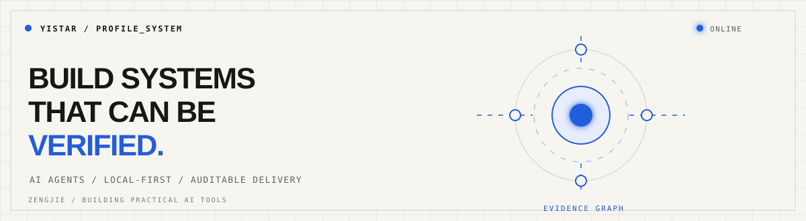
</picture>

  I build open-source tools that make AI coding agents <strong>controllable, verifiable, and easy to fit into real workflows</strong>: 
  driving local agents from ChatGPT web, aligning requirements before execution, and auditable local runs.

  
  
  
  
  

<picture>
  <source media="(prefers-color-scheme: dark)" srcset="./assets/profile-intro-dark.svg" />
  <source media="(prefers-color-scheme: light)" srcset="./assets/profile-intro-light.svg" />
  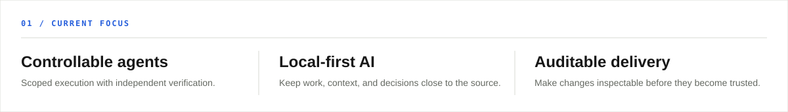
</picture>

  <a href="https://yistar.jiezeng2004.me">Personal site</a>
  &middot;
  <a href="https://github.com/jiezeng2004-design?tab=repositories&type=source">Original repositories</a>
  &middot;
  <a href="https://github.com/jiezeng2004-design/dsh-chatgpt-bridge">dsh-chatgpt-bridge</a>
  &middot;
  <a href="https://github.com/jiezeng2004-design/PatchWarden">PatchWarden</a>

---

### `// FEATURED_SYSTEMS` - Selected work

<table>
  <tr>
    <td colspan="2" valign="top">
      <code>MOST STARRED / 01</code>
      
<strong><a href="https://github.com/jiezeng2004-design/dsh-chatgpt-bridge">dsh-chatgpt-bridge - View repository &rarr;</a></strong>

      <a href="https://github.com/jiezeng2004-design/dsh-chatgpt-bridge">
        <picture>
          <source media="(prefers-color-scheme: dark)" srcset="./assets/project-dshbridge-dark.svg" />
          <source media="(prefers-color-scheme: light)" srcset="./assets/project-dshbridge-light.svg" />
          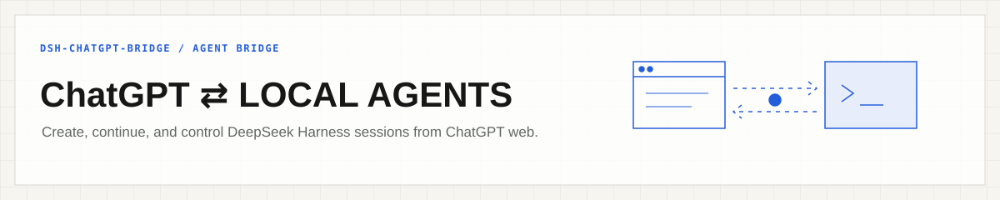
        </picture>
      </a>
      
<strong>An MCP bridge that lets ChatGPT web create, view, continue, and control DeepSeek Harness agent sessions.</strong>

      
  <code>JavaScript</code> <code>MCP</code> <code>ChatGPT</code>

      
<a href="https://github.com/jiezeng2004-design/dsh-chatgpt-bridge">Repository</a> &middot; <a href="https://github.com/jiezeng2004-design/dsh-chatgpt-bridge/releases">Releases</a>

    </td>
  </tr>
  <tr>
    <td colspan="2" valign="top">
      <code>GUARDRAILS / 02</code>
      
<strong><a href="https://github.com/jiezeng2004-design/PatchWarden">PatchWarden - View repository &rarr;</a></strong>

      <a href="https://github.com/jiezeng2004-design/PatchWarden">
        <picture>
          <source media="(prefers-color-scheme: dark)" srcset="./assets/project-patchwarden-dark.svg" />
          <source media="(prefers-color-scheme: light)" srcset="./assets/project-patchwarden-light.svg" />
          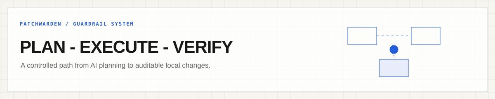
        </picture>
      </a>
      
<strong>Turn approved AI plans into guarded, auditable local execution. Listed in awesome-mcp-servers.</strong>

      
  <code>TypeScript</code> <code>MCP</code> <code>Verification</code>

      
<a href="https://github.com/jiezeng2004-design/PatchWarden">Repository</a> &middot; <a href="https://github.com/jiezeng2004-design/PatchWarden/releases">Releases</a> &middot; <a href="https://patchwarden-showcase-redesign.yistart.chatgpt.site">Showcase</a>

    </td>
  </tr>
  <tr>
    <td width="50%" valign="top">
      <code>ALIGNMENT / 03</code>
      
<strong><a href="https://github.com/jiezeng2004-design/dsh-requirements-alignment">dsh-requirements-alignment &rarr;</a></strong>

      <a href="https://github.com/jiezeng2004-design/dsh-requirements-alignment">
        <picture>
          <source media="(prefers-color-scheme: dark)" srcset="./assets/project-alignment-dark.svg" />
          <source media="(prefers-color-scheme: light)" srcset="./assets/project-alignment-light.svg" />
          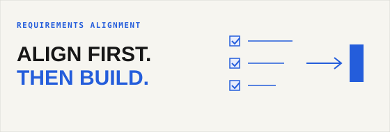
        </picture>
      </a>
      
<strong>Align important decisions before execution so agents guess less and rework less, without a full spec workflow.</strong>

      
 <code>TypeScript</code> <code>npm</code>

      
<a href="https://github.com/jiezeng2004-design/dsh-requirements-alignment">Repository</a> &middot; <a href="https://www.npmjs.com/package/dsh-requirements-alignment">npm</a>

    </td>
    <td width="50%" valign="top">
      <code>SESSION REFERENCE / 04</code>
      
<strong><a href="https://github.com/jiezeng2004-design/agentref">agentref &rarr;</a></strong>

      <a href="https://github.com/jiezeng2004-design/agentref">
        <picture>
          <source media="(prefers-color-scheme: dark)" srcset="./assets/project-agentref-dark.svg" />
          <source media="(prefers-color-scheme: light)" srcset="./assets/project-agentref-light.svg" />
          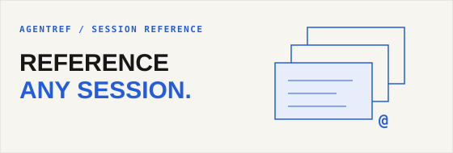
        </picture>
      </a>
      
<strong>Local, read-only session references across AI coding agents, with native menus for Codex and Claude Code.</strong>

      
 <code>Python</code> <code>Codex</code> <code>Claude Code</code>

      
<a href="https://github.com/jiezeng2004-design/agentref">Repository</a>

    </td>
  </tr>
</table>

<!-- profile:auto:latest-en:start -->
### `// MORE_PROJECTS` - Also shipped

<table>
  <tr>
    <td width="50%" valign="top">
      <code>LOCAL GATEWAY / v0.3.3</code>
      
<strong><a href="https://github.com/jiezeng2004-design/relay-forge">RelayForge &rarr;</a></strong>

      
Local-first AI coding gateway with combo routing, fallback, privacy logs, and OpenAI/Anthropic compatibility.

      
<code>JavaScript</code> <code>Gateway</code> <code>Local-first</code>

      
<a href="https://github.com/jiezeng2004-design/relay-forge">Repository</a> &middot; <a href="https://github.com/jiezeng2004-design/relay-forge/releases/tag/v0.3.3">v0.3.3</a>

    </td>
    <td width="50%" valign="top">
      <code>WORK MEMORY / v1.4.3</code>
      
<strong><a href="https://github.com/jiezeng2004-design/CodexJournal-Lite">CodexJournal-Lite &rarr;</a></strong>

      
Turn local Codex sessions into a searchable private work memory and dashboard.

      
<code>JavaScript</code> <code>Codex</code> <code>Local-first</code>

      
<a href="https://github.com/jiezeng2004-design/CodexJournal-Lite">Repository</a> &middot; <a href="https://github.com/jiezeng2004-design/CodexJournal-Lite/releases/tag/v1.4.3">v1.4.3</a>

    </td>
  </tr>
  <tr>
    <td width="50%" valign="top">
      <code>MODEL PROBING / v0.1.0</code>
      
<strong><a href="https://github.com/jiezeng2004-design/ProbeMux">ProbeMux &rarr;</a></strong>

      
Probe once, configure everywhere: evidence-first model capability probing for coding agents.

      
<code>TypeScript</code> <code>CLI</code> <code>LLM</code>

      
<a href="https://github.com/jiezeng2004-design/ProbeMux">Repository</a> &middot; <a href="https://github.com/jiezeng2004-design/ProbeMux/releases/tag/v0.1.0">v0.1.0</a>

    </td>
    <td width="50%" valign="top">
      <code>DESKTOP THEME / v0.3.0</code>
      
<strong><a href="https://github.com/jiezeng2004-design/XJTU-Codex-Theme">XJTU-Codex-Theme &rarr;</a></strong>

      
No-restart themes for Codex Desktop, with an XJTU preset and a custom template.

      
<code>JavaScript</code> <code>Electron</code> <code>Theme</code>

      
<a href="https://github.com/jiezeng2004-design/XJTU-Codex-Theme">Repository</a> &middot; <a href="https://github.com/jiezeng2004-design/XJTU-Codex-Theme/releases/tag/v0.3.0">v0.3.0</a>

    </td>
  </tr>
</table>
<!-- profile:auto:latest-en:end -->

Also: <a href="https://github.com/jiezeng2004-design/creator-pulse">creator-pulse</a> &middot; <a href="https://github.com/jiezeng2004-design/x-algorithm-auditor">x-algorithm-auditor</a> &middot; <a href="https://github.com/jiezeng2004-design/DraftPulse">DraftPulse</a> &middot; <a href="https://github.com/jiezeng2004-design/requirements-alignment">requirements-alignment</a>

### `// UPSTREAM_CONTRIBUTIONS` - Merged into other projects

<table>
  <tr>
    <td valign="top"><a href="https://github.com/punkpeye/awesome-mcp-servers"><strong>punkpeye/awesome-mcp-servers</strong></a> </td>
    <td valign="top">Added PatchWarden to Developer Tools · <a href="https://github.com/punkpeye/awesome-mcp-servers/pull/8677">#8677</a></td>
  </tr>
  <tr>
    <td valign="top"><a href="https://github.com/awesome-dsh-plugin/awesome-dsh-plugin"><strong>awesome-dsh-plugin</strong></a> </td>
    <td valign="top">Listed dsh-chatgpt-bridge and dsh-requirements-alignment, added screenshots · <a href="https://github.com/awesome-dsh-plugin/awesome-dsh-plugin/pull/573">#573</a> <a href="https://github.com/awesome-dsh-plugin/awesome-dsh-plugin/pull/1138">#1138</a> <a href="https://github.com/awesome-dsh-plugin/awesome-dsh-plugin/pull/1155">#1155</a></td>
  </tr>
  <tr>
    <td valign="top"><a href="https://github.com/openclaw/mcporter"><strong>openclaw/mcporter</strong></a> </td>
    <td valign="top">Safety guidance for generated CLIs and replay fixtures · <a href="https://github.com/openclaw/mcporter/pull/238">#238</a></td>
  </tr>
</table>

<!-- profile:auto:snapshot-en:start -->
### `// GITHUB_SNAPSHOT` - Public profile data

<table>
  <tr>
    <td align="center"><strong>14</strong> Original projects</td>
    <td align="center"><strong>50</strong> Total stars</td>
    <td align="center"><strong>11</strong> Total forks</td>
    <td align="center"><strong>9</strong> PRs merged upstream</td>
  </tr>
</table>

Refreshed weekly · 2026-11-22 · non-archived original repositories only

<!-- profile:auto:snapshot-en:end -->

### `// CONTRIBUTION_SIGNAL` - Building in public

<picture>
  <source media="(prefers-color-scheme: dark)" srcset="https://raw.githubusercontent.com/jiezeng2004-design/jiezeng2004-design/output/github-contribution-grid-snake-dark.svg" />
  <source media="(prefers-color-scheme: light)" srcset="https://raw.githubusercontent.com/jiezeng2004-design/jiezeng2004-design/output/github-contribution-grid-snake.svg" />
  
</picture>

   
  <a href="https://yistar.jiezeng2004.me">yistar.jiezeng2004.me</a>

