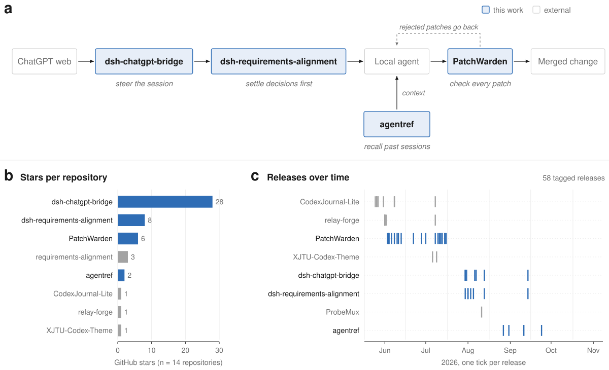

## yistar

Tools for running AI coding agents under control &nbsp;·&nbsp; <a href="https://yistar.jiezeng2004.me">website</a> &nbsp;·&nbsp; <a href="https://github.com/jiezeng2004-design?tab=repositories&type=source">all repositories</a>

**Abstract.** Coding agents are useful but hard to steer, and harder to check afterwards. I build small, local-first tools that sit around an agent run. One lets me start and steer sessions from ChatGPT; one settles the important decisions before any code is written; one checks every patch before it lands; and one lets an agent look back at earlier sessions. Fig. 1a shows how they connect. Table 1 lists the projects, and Table 2 lists changes I've had merged elsewhere.

<picture>
  <source media="(prefers-color-scheme: dark)" srcset="./assets/fig1-dark.svg" />
  <source media="(prefers-color-scheme: light)" srcset="./assets/fig1-light.svg" />
  
</picture>

<!-- profile:auto:fig1-caption:start -->
**Fig. 1 | How the projects fit together.** **a**, An agent run from request to merged change. Blue boxes are my projects; grey boxes are the tools they connect. A patch that fails PatchWarden's checks goes back to the agent instead of landing. **b**, Stars per repository, for the 8 of my 14 original repositories that have any. **c**, Every tagged release of the eight projects in Table 1, June–November 2026 (58 in total).
<!-- profile:auto:fig1-caption:end -->

 

**Table 1 | Projects.** The four projects shown in blue in Fig. 1a come first.

<!-- profile:auto:table1:start -->
<table>
  <tr><th>Project</th><th>What it does</th><th>Stars</th><th>Latest release</th></tr>
  <tr>
    <td><a href="https://github.com/jiezeng2004-design/dsh-chatgpt-bridge"><b>dsh-chatgpt-bridge</b></a></td>
    <td>Steer local agent sessions from ChatGPT.</td>
    <td align="right">28</td>
    <td><a href="https://github.com/jiezeng2004-design/dsh-chatgpt-bridge/releases/tag/v0.6.0">v0.6.0</a></td>
  </tr>
  <tr>
    <td><a href="https://github.com/jiezeng2004-design/dsh-requirements-alignment"><b>dsh-requirements-alignment</b></a></td>
    <td>Settle key decisions before any code.</td>
    <td align="right">8</td>
    <td><a href="https://github.com/jiezeng2004-design/dsh-requirements-alignment/releases/tag/v0.5.0-rc.1">v0.5.0-rc.1</a></td>
  </tr>
  <tr>
    <td><a href="https://github.com/jiezeng2004-design/PatchWarden"><b>PatchWarden</b></a></td>
    <td>Check every patch before it lands.</td>
    <td align="right">6</td>
    <td><a href="https://github.com/jiezeng2004-design/PatchWarden/releases/tag/v1.7.2">v1.7.2</a></td>
  </tr>
  <tr>
    <td><a href="https://github.com/jiezeng2004-design/agentref"><b>agentref</b></a></td>
    <td>Read-only recall of past agent sessions.</td>
    <td align="right">2</td>
    <td><a href="https://github.com/jiezeng2004-design/agentref/releases/tag/v0.1.0-alpha.4">v0.1.0-alpha.4</a></td>
  </tr>
  <tr>
    <td><a href="https://github.com/jiezeng2004-design/relay-forge"><b>relay-forge</b></a></td>
    <td>Local gateway with provider fallback.</td>
    <td align="right">1</td>
    <td><a href="https://github.com/jiezeng2004-design/relay-forge/releases/tag/v0.3.3">v0.3.3</a></td>
  </tr>
  <tr>
    <td><a href="https://github.com/jiezeng2004-design/CodexJournal-Lite"><b>CodexJournal-Lite</b></a></td>
    <td>Searchable archive of Codex sessions.</td>
    <td align="right">1</td>
    <td><a href="https://github.com/jiezeng2004-design/CodexJournal-Lite/releases/tag/v1.4.3">v1.4.3</a></td>
  </tr>
  <tr>
    <td><a href="https://github.com/jiezeng2004-design/ProbeMux"><b>ProbeMux</b></a></td>
    <td>Probe a model once, configure every agent.</td>
    <td align="right">0</td>
    <td><a href="https://github.com/jiezeng2004-design/ProbeMux/releases/tag/v0.1.0">v0.1.0</a></td>
  </tr>
  <tr>
    <td><a href="https://github.com/jiezeng2004-design/XJTU-Codex-Theme"><b>XJTU-Codex-Theme</b></a></td>
    <td>No-restart themes for Codex Desktop.</td>
    <td align="right">1</td>
    <td><a href="https://github.com/jiezeng2004-design/XJTU-Codex-Theme/releases/tag/v0.3.0">v0.3.0</a></td>
  </tr>
</table>
<!-- profile:auto:table1:end -->

 

<!-- profile:auto:table2-caption:start -->
**Table 2 | Changes merged into other projects.** Selected pull requests; 9 of mine have been merged into repositories I don't own.
<!-- profile:auto:table2-caption:end -->

<table>
  <tr><th>Repository</th><th>Change</th><th>Pull request</th></tr>
  <tr>
    <td><a href="https://github.com/punkpeye/awesome-mcp-servers"><b>punkpeye/awesome-mcp-servers</b></a></td>
    <td>Listed PatchWarden</td>
    <td><a href="https://github.com/punkpeye/awesome-mcp-servers/pull/8677">#8677</a></td>
  </tr>
  <tr>
    <td><a href="https://github.com/awesome-dsh-plugin/awesome-dsh-plugin"><b>awesome-dsh-plugin</b></a></td>
    <td>Listed two DSH plugins</td>
    <td><a href="https://github.com/awesome-dsh-plugin/awesome-dsh-plugin/pull/573">#573</a>, <a href="https://github.com/awesome-dsh-plugin/awesome-dsh-plugin/pull/1138">#1138</a>, <a href="https://github.com/awesome-dsh-plugin/awesome-dsh-plugin/pull/1155">#1155</a></td>
  </tr>
  <tr>
    <td><a href="https://github.com/openclaw/mcporter"><b>openclaw/mcporter</b></a></td>
    <td>Safety docs for generated CLIs</td>
    <td><a href="https://github.com/openclaw/mcporter/pull/238">#238</a></td>
  </tr>
</table>

 

Also on this account: <a href="https://github.com/jiezeng2004-design/creator-pulse">creator-pulse</a>, <a href="https://github.com/jiezeng2004-design/x-algorithm-auditor">x-algorithm-auditor</a>, <a href="https://github.com/jiezeng2004-design/DraftPulse">DraftPulse</a>, <a href="https://github.com/jiezeng2004-design/requirements-alignment">requirements-alignment</a>. Figure and tables are regenerated weekly from the GitHub API.
